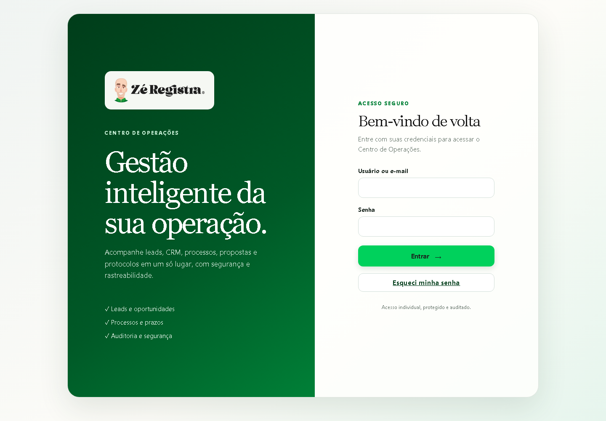
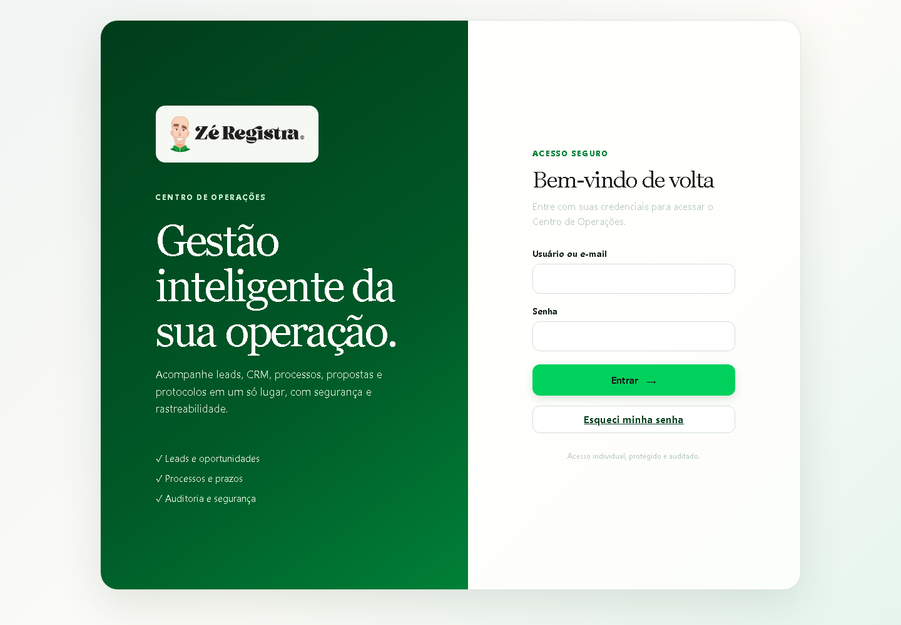
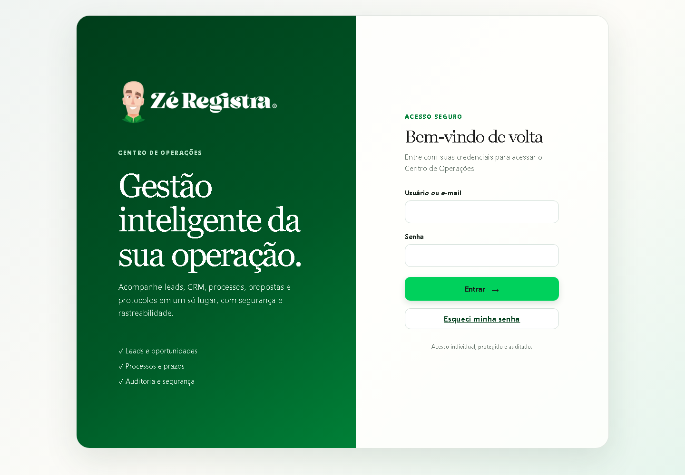
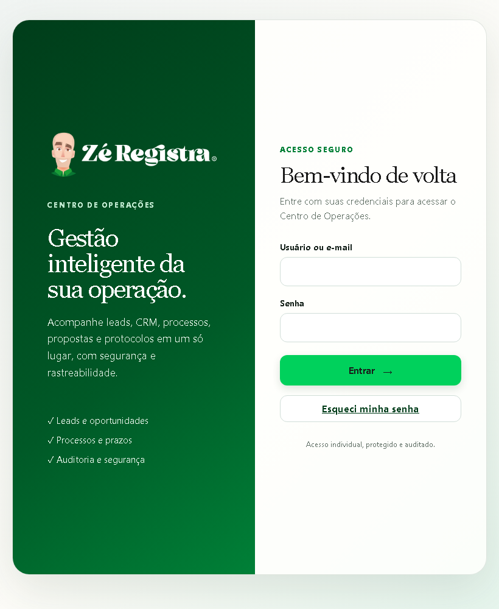
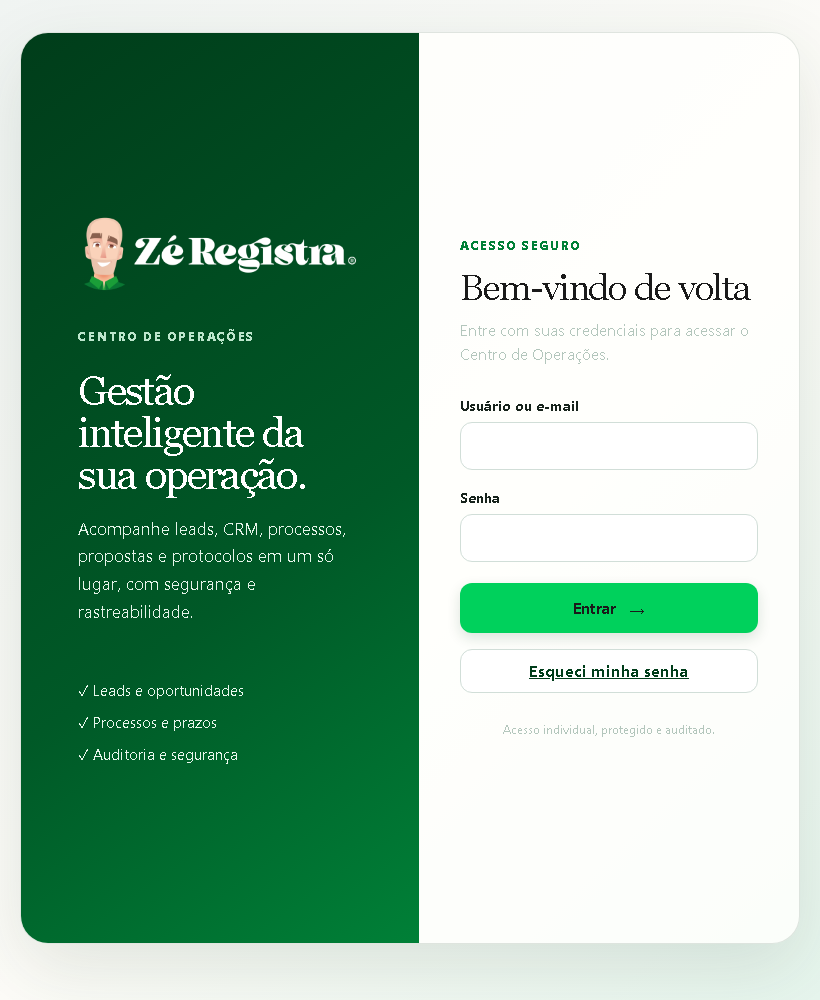
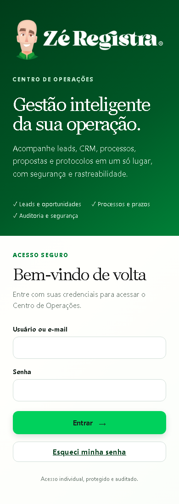
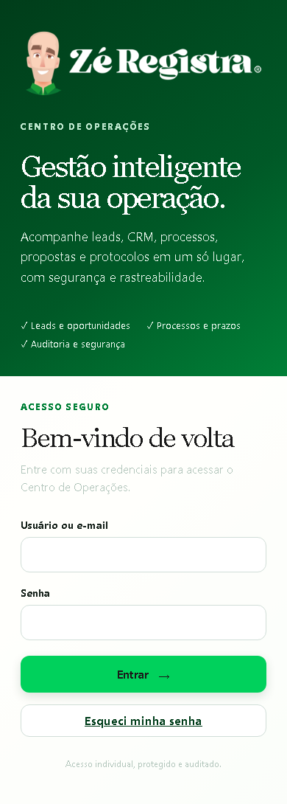

# Logo oficial no login do Centro de Operações

O login usa a variante oficial com letras brancas diretamente sobre o painel verde. O mascote conserva suas cores, sem filtros, recorte ou cartão branco. As duas imagens fornecidas foram copiadas sem reprocessamento (1688 × 504, PNG RGBA).

A variante com letras escuras fica disponível em assets para superfícies claras. Ela não é aplicada ao painel verde, inclusive quando a classe de tema existente `.dark` está ativa. O projeto declara os tokens desse tema em styles.css. Não foi encontrado um controle de alternância nos scripts atuais do login, e nenhum mecanismo novo foi criado.

A mudança de apresentação está em ops-login-brand.css, carregado somente pelo login. O seletor exige a classe do login e o caminho da imagem oficial. Assim, quando auth-pages.js substitui a imagem por uma marca própria, o cartão claro existente volta a valer. O nome de escritório sem logo também continua funcionando.

A referência antiga logo-zeregistra.png também aparece em portal-cliente.html. Esse arquivo, a imagem antiga, os estilos compartilhados e o JavaScript de autenticação não foram alterados.

O novo nome de imagem evita reutilizar o cache do arquivo antigo. A imagem e a nova folha de estilos têm versão na URL. A configuração examinada usa StaticFiles do FastAPI e proxy Nginx sem regra específica de cache estático. Não houve alteração global de cache nem consulta de purga em produção.

## Validação

Os 16 casos da suíte tests/frontend passaram, incluindo dois casos novos para a logo e marca própria. A execução de `node --test tests/frontend/*.test.cjs` e a tentativa com `--test-isolation=none` não encerraram no executor Windows. A validação foi concluída executando os callbacks originais dos testes, sequencialmente, no runtime Node disponível, com Chromium Playwright local e sem alterar as asserções. Esse resultado não equivale a uma execução completa de CI.

Foram verificadas as larguras 1440, 820, 390 e 320 px, com e sem a classe .dark: carregamento da imagem, proporção original, ausência de filtro, fundo transparente, ausência de borda e padding, contenção no painel e ausência de rolagem horizontal. Nenhum erro JavaScript foi observado nessa matriz. A inspeção visual incluiu desktop, tablet e celular.

As imagens integradas são idênticas byte a byte aos anexos. SHA-256 da variante clara: `7a7affc040ebc4de1be6f59e3988d4a909fd77c36d734f1a63ad0883b7c95fa3`. SHA-256 da variante escura: `f544f7a4f316b7243a92976c2558d2ec5a0e855ca0984fa9077f0dae5e6da6ea`.

As capturas usam fontes e recursos locais, com APIs simuladas e sem credenciais. Nenhum login real, deploy, alteração de banco ou merge foi executado. Os testes de backend e as jornadas E2E com servidor e banco reais não foram executados neste ambiente.

## Capturas

| Tela | Claro | Escuro |
| --- | --- | --- |
| Desktop antes |  |  |
| Desktop depois |  |  |
| Tablet depois |  |  |
| Celular depois |  |  |
