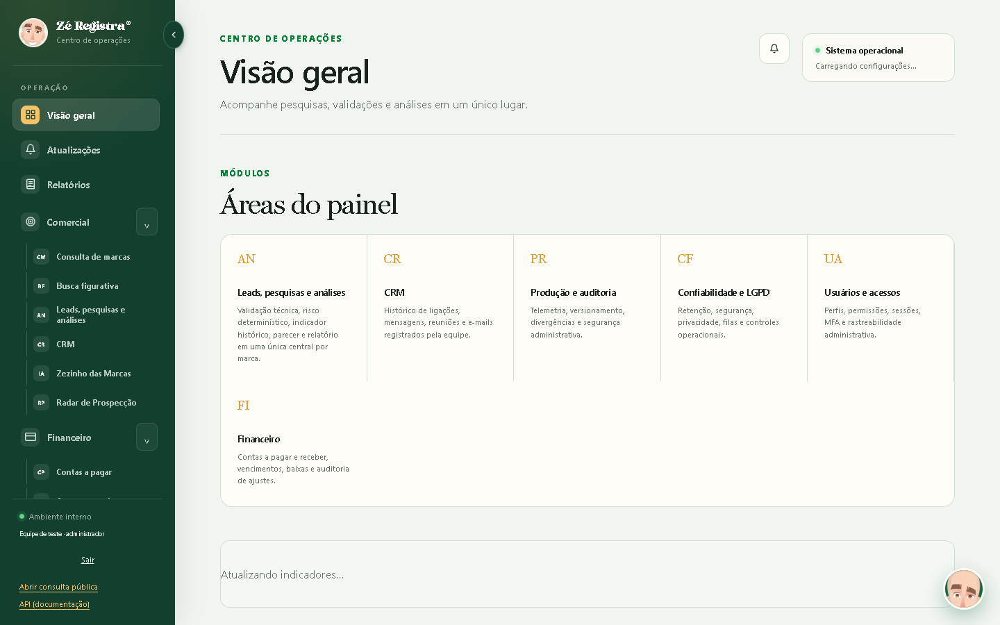
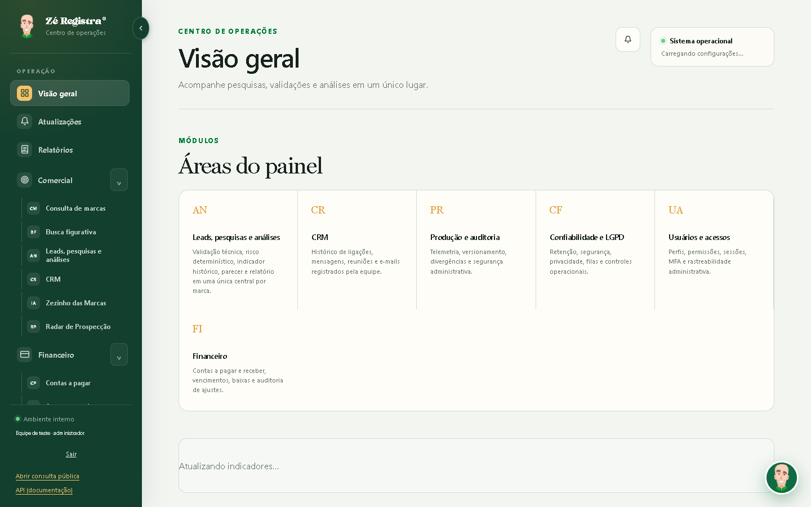
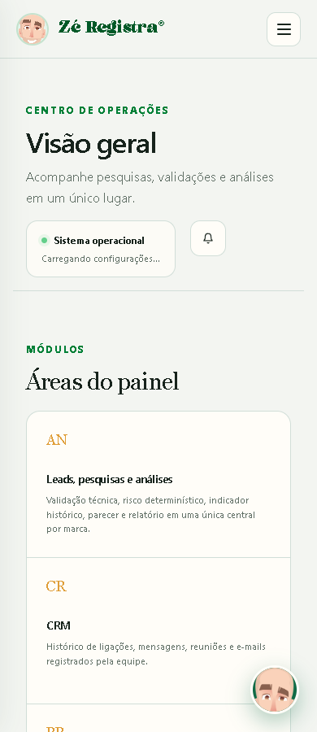
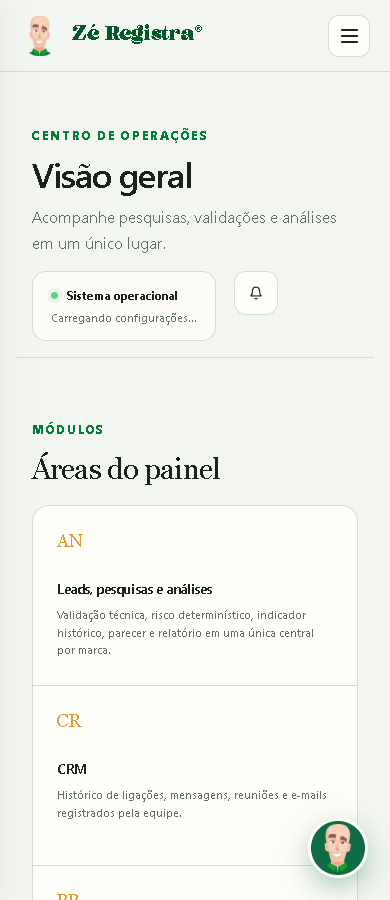
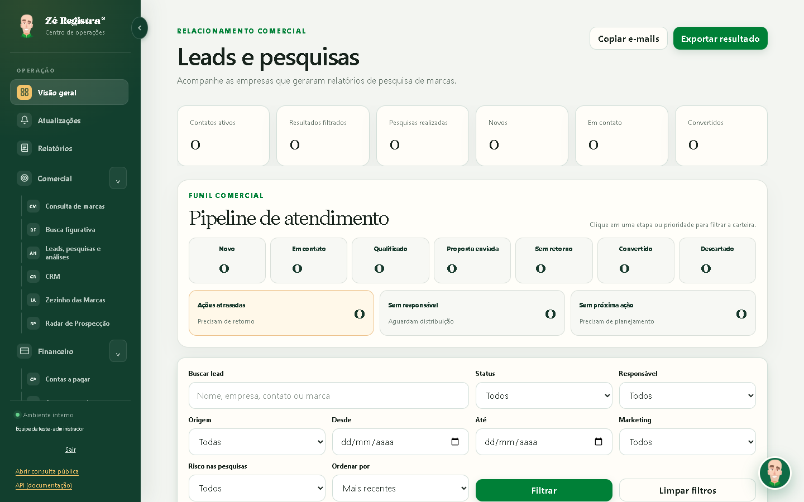
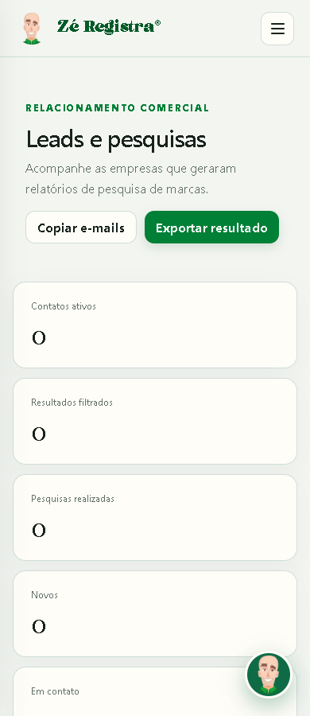

# Identidade visual do Centro de Operações

A causa da mudança aparente do personagem era a aplicação de CSS diferente entre módulos. O shell já usava personagem.png na barra lateral, cabeçalho móvel e assistente. styles.css aplicava object-fit:cover, posição 27% e avatar circular. Somente Leads, Análise e Radar carregavam operations-list.css, que corrigia o recorte e a grade do assistente. A imagem retrato de 592 × 1050 ocupava uma caixa quadrada, com partes do rosto e da roupa cortadas. As capturas reproduzem o problema antes da alteração.

As regras de identidade foram movidas integralmente para styles.css, com escopo .admin-body. As dimensões externas e a posição dos componentes foram preservadas. A grade e o padding interno de 3px do assistente passaram a valer em todos os módulos para impedir que a imagem exceda o botão. operations-list.css mantém apenas estilos de listas. admin-shell.js passa a declarar a URL do personagem uma única vez, usada nas três posições.

A referência documental da identidade oficial é docs/login-logo/README.md, que registra as duas imagens fornecidas, sem reprocessamento. A comparação visual do personagem.png com ze-registra-logo-tema-claro.png confirmou os mesmos traços e cores. Por isso, o arquivo original personagem.png foi mantido integralmente (SHA-256 9cd2a7e627edc066093e272c407b799d12532883dd26034f198670d5b1470442). Não houve substituição de arte ou geração de imagem. As variantes horizontais oficiais continuam disponíveis nos temas e usos existentes.

| Asset | Dimensões | Uso encontrado |
| --- | --- | --- |
| personagem.png | 592 × 1050 | Shell interno, páginas públicas, autenticação e relatórios PDF |
| ze-registra-logo-tema-claro.png | 1688 × 504 | Variante oficial com letras escuras, disponível para superfícies claras |
| ze-registra-logo-tema-escuro.png | 1688 × 504 | Variante oficial com letras brancas usada no login |
| logo-zeregistra.png | 1570 × 460 | Logo anterior ainda usada no portal do cliente e em PDF |
| mascote-foguete.png | 1254 × 1254 | Portal do cliente e jornada com logo do cliente sobreposta |
| favicon-personagem.png | 256 × 256 | Favicon do relatório público |

Os seis assets têm hashes diferentes. O inventário completo com hashes está em assets.json. As variantes anteriores e o mascote do portal possuem referências ativas e foram preservados. O recorte circular do favicon tem finalidade distinta e não é carregado pelo shell interno. Os arquivos de evidência em docs/login-logo também foram preservados.

A auditoria de referências incluiu HTML, CSS, scripts, geração de PDF e os mecanismos dinâmicos de marca. No painel, /v1/auth/me pode substituir apenas a marca da barra lateral e do cabeçalho por organizacao.marca, com retorno à imagem padrão em caso de erro. O assistente continua sendo o personagem da plataforma. O CSS da marca própria vem de /v1/auth/me/marca.css. Nas páginas públicas e autenticação, tenant-branding.js e auth-pages.js aplicam a marca do escritório. O portal usa sua própria composição dinâmica de mascote e logo de cliente. Esses comportamentos não foram alterados.

Todos os 42 HTML que carregam admin-shell.js foram atualizados para styles.css?v=70 e admin-shell.js?v=57. Os três módulos com operações de listas usam operations-list.css?v=2. A URL compartilhada do personagem passa a ter ?v=1. Os caminhos começam por /static/, sem dependência da profundidade da rota. O versionamento segue o padrão existente do projeto. app/observability.py já fornece Cache-Control:no-cache para JS/CSS, com revalidação por ETag/Last-Modified do StaticFiles. O Nginx examinado encaminha ao aplicativo e não define cache de assets próprio. Não foi encontrado service worker no código pesquisado. Cache não foi necessário para reproduzir a falha e não é sua causa demonstrada. Nenhuma configuração de cache ou purga de produção foi alterada.

A lista de rotas e aliases cobertos está em routes.json. Ela inclui Visão Geral, Atualizações, Relatórios, Leads e Pesquisas, Análises, Radar, Consulta de Marcas, CRM, Financeiro, Jurídico, Produção e configurações administrativas.

A validação executou os 26 testes existentes em tests/frontend e os 3 novos de operations-brand.test.cjs, todos aprovados com o runner node --test e Chromium local. A nova matriz usa os 42 templates reais, suas folhas de estilo e o shell real em 48 rotas, nas larguras 1440 e 390. Os scripts específicos de módulos são retirados apenas dessa fixture para isolar a identidade compartilhada. Os testes existentes de Leads, Radar, CRM, propostas, login e Carteira executam os scripts de seus respectivos módulos.

Foram verificadas navegação por links, acesso direto, recarga, menu móvel, abertura do assistente, carregamento das imagens, contain, centralização, ausência de filtro e contenção no botão. O assistente flutuante continua ausente na sua página dedicada, conforme comportamento anterior. A matriz de shell não registrou pageerror. Marca própria e fallback também passaram. As requisições de imagem do painel padrão foram decodificadas com sucesso. O caso de logo própria indisponível provoca um 404 intencional e verifica sua recuperação. git diff --check passou.

As capturas foram feitas antes e depois com APIs simuladas, fontes e arquivos locais, sem credenciais. A inspeção visual comparou desktop e celular da Visão Geral e a preservação do padrão de Leads. Não houve validação autenticada em produção, execução de backend, banco real, migrations, deploy ou merge. A publicação depende da revisão do PR e da verificação integrada em ambiente de homologação. Não foi identificada pendência de aprovação da identidade visual.

| Tela | Antes | Depois |
| --- | --- | --- |
| Visão Geral 1440 |  |  |
| Visão Geral 390 |  |  |
| Leads 1440 |  |  |
| Leads 390 |  |  |
