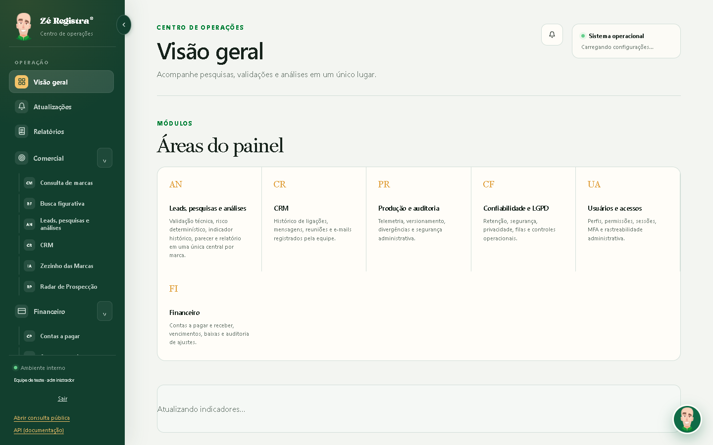

# Cabeçalho da identidade na barra lateral

Correção exclusivamente visual sobre a versão 1.2.30 (main ac9184b). O cabeçalho é gerado por createAdminShell em admin-shell.js. A composição continua usando o personagem original /static/assets/personagem.png?v=1, o nome Zé Registra e o subtítulo Centro de operações. Não houve alteração de JavaScript, menus ou arquivos de imagem.

O PNG tem 592 × 1050 pixels. Dentro da antiga caixa de 42 × 42 pixels, object-fit:contain reduzia a arte a aproximadamente 23,7 pixels de largura visível. A caixa passa a 42 × 56 pixels, exibindo o personagem inteiro com aproximadamente 31,6 pixels de largura visível. A resolução original excede a dimensão de exibição com folga. Não foram aplicados recorte, filtro ou transformação na imagem.

O bloco de textos usa uma coluna flexível com intervalo de 4 pixels. Nome e subtítulo têm a mesma origem horizontal, e o conjunto é centralizado verticalmente com o personagem. A família Pigura do nome, o tamanho de 1.16rem e as cores anteriores foram preservados. Foram explicitadas apenas as alturas de linha para estabilizar a composição.

O espaçamento inferior do cabeçalho passou de 26 para 12 pixels, compensando os 14 pixels adicionados à altura da imagem. O cabeçalho conserva 69 pixels de altura, a divisória e o menu continuam na coordenada vertical 95, e a barra lateral mantém 252 pixels expandida ou 76 pixels recolhida. O personagem fica centralizado no estado recolhido, enquanto os textos continuam ocultos pela regra existente.

A mudança funcional de estilo está somente em app/web/static/styles.css. Os 42 templates internos receberam apenas a atualização de styles.css?v=70 para styles.css?v=71, seguindo o padrão de cache já usado pelo projeto. O shell continua em v57. Login, páginas públicas, cabeçalho móvel e avatar flutuante não recebem novas regras. A comparação antes/depois verificou igualdade de dimensões e estilos do cabeçalho móvel e do avatar flutuante nas capturas.

O hash SHA-256 de personagem.png permanece 9cd2a7e627edc066093e272c407b799d12532883dd26034f198670d5b1470442, idêntico ao inventário oficial de docs/operations-brand/assets.json. A referência documental da identidade permanece docs/login-logo/README.md.

Os novos testes de sidebar-header.test.cjs verificam a identidade por hash, alinhamento, proporção, ausência de filtro, tipografia, cores e contenção em seis páginas (Visão Geral, Atualizações, Relatórios, Leads, Radar e Consulta), nas larguras 1440, 1024, 820 e 390. Também verificam recolher, expandir e recarregar a barra lateral. A suíte existente de identidade cobre os 42 templates e suas 48 rotas e aliases. O arquivo metricas.json registra a comparação antes/depois das capturas.

As capturas são locais, com HTML/CSS e shell reais e APIs simuladas. Os scripts específicos dos módulos foram isolados nessas fixtures. Não houve validação autenticada em produção nem deploy. Nenhum print estava acessível na mensagem desta solicitação, então o componente e a arte oficial da versão 1.2.30 foram usados como referência.

| Estado | Antes | Depois |
| --- | --- | --- |
| Desktop expandida |  |  |
| Desktop recolhida |  |  |
| Tablet 820 |  |  |
| Celular 390 |  |  |

Resultado da execução: `node --test tests/frontend/*.test.cjs` aprovou os 31 testes, sem falhas ou ignorados. `git diff --check` também passou. Backend e E2E com banco real não foram executados localmente para esta alteração de CSS.
